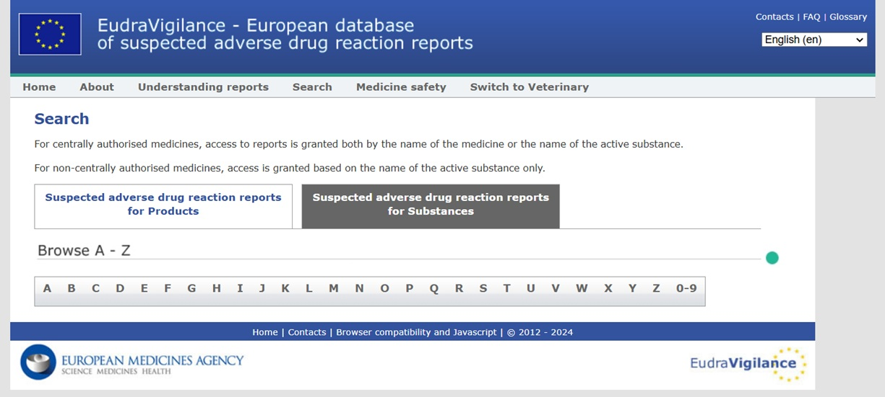
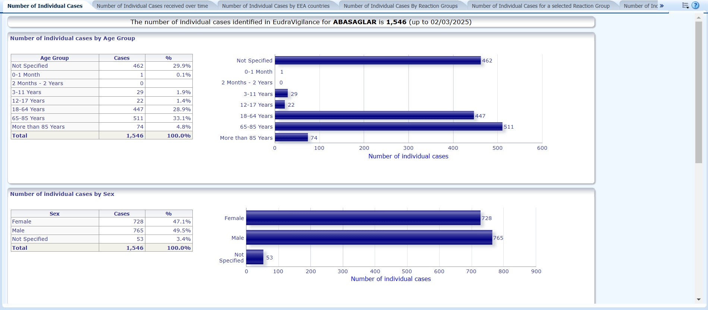
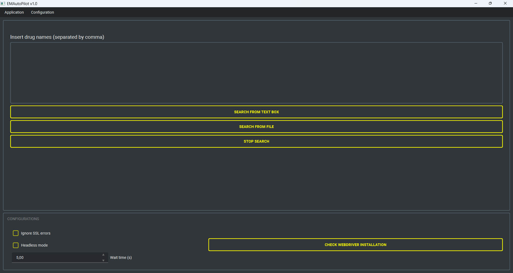

> **Archived - no longer maintained.**

# EMADB AutoPilot

Automated retrieval of EMA EudraVigilance adverse drug reaction reports.

 

## Archived notice

This project is no longer maintained or updated and will not receive future updates. It is preserved for reference; dependencies and external sites may have changed.

## Overview

EMADB AutoPilot automates navigation of the EMA EudraVigilance database (https://www.adrreports.eu/en/search.html) to download suspected adverse drug reaction reports as Excel files for drugs listed in `resources/drugs_to_search.txt`. ChromeDriver drives a Chrome browser to simulate user interaction. EudraVigilance is the European database of suspected adverse drug reaction reports (ICSRs) used by the EMA, national competent authorities, marketing authorization holders, and clinical trial sponsors in the EEA.

## Technology Stack

| Technology | Version |
|---|---|
| Python | unspecified |
| Selenium / ChromeDriver | unspecified |
| Google Chrome | required (external) |

## Installation (legacy)

Windows only. Run `start_on_windows.bat` from the repository root. On first run it installs a portable Python runtime and dependencies, then launches the app. Some antivirus software (e.g. Avast) may flag `python.exe` invoked by the batch file; add an exception if needed.

## Screenshots

<kbd></kbd>
*Archived screenshot: search page at https://www.adrreports.eu/en/search.html*

<kbd></kbd>
*Archived screenshot: suspected adverse drug reaction report for Abasaglar*

<kbd></kbd>
*Archived screenshot: main application UI*

## Configuration

- `resources/drugs_to_search.txt`: one drug name per line; drives the search.
- `setup/.env`: environment configuration (copy from template if present).
- Downloaded reports are saved to `resources/download`; logs to `resources/logs`.

## Documentation links

None in repository. EudraVigilance search: https://www.adrreports.eu/en/search.html

## License

MIT. See [LICENSE](LICENSE).
